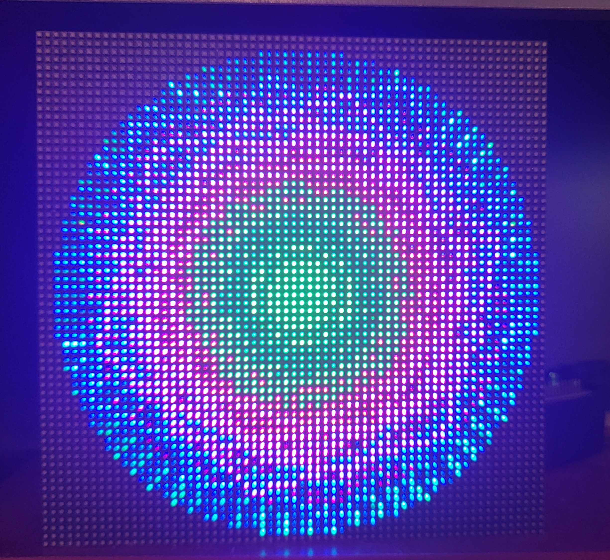
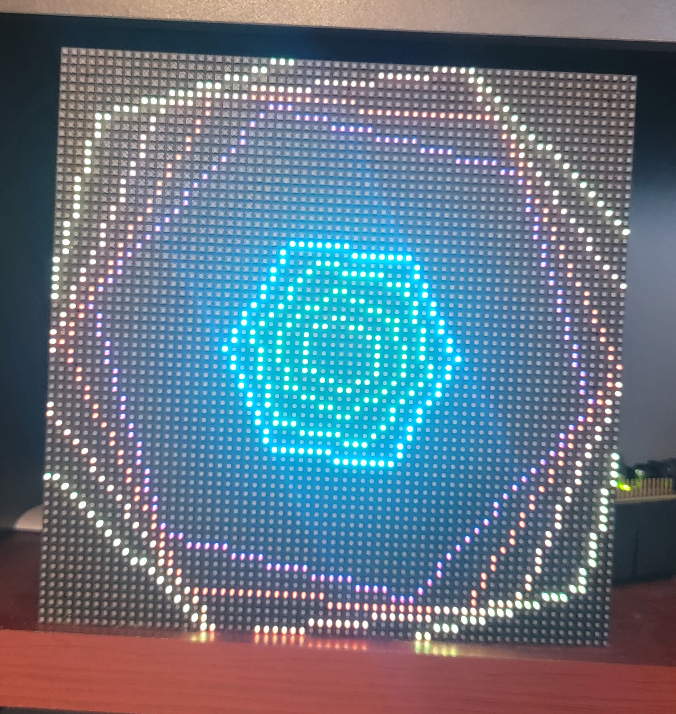
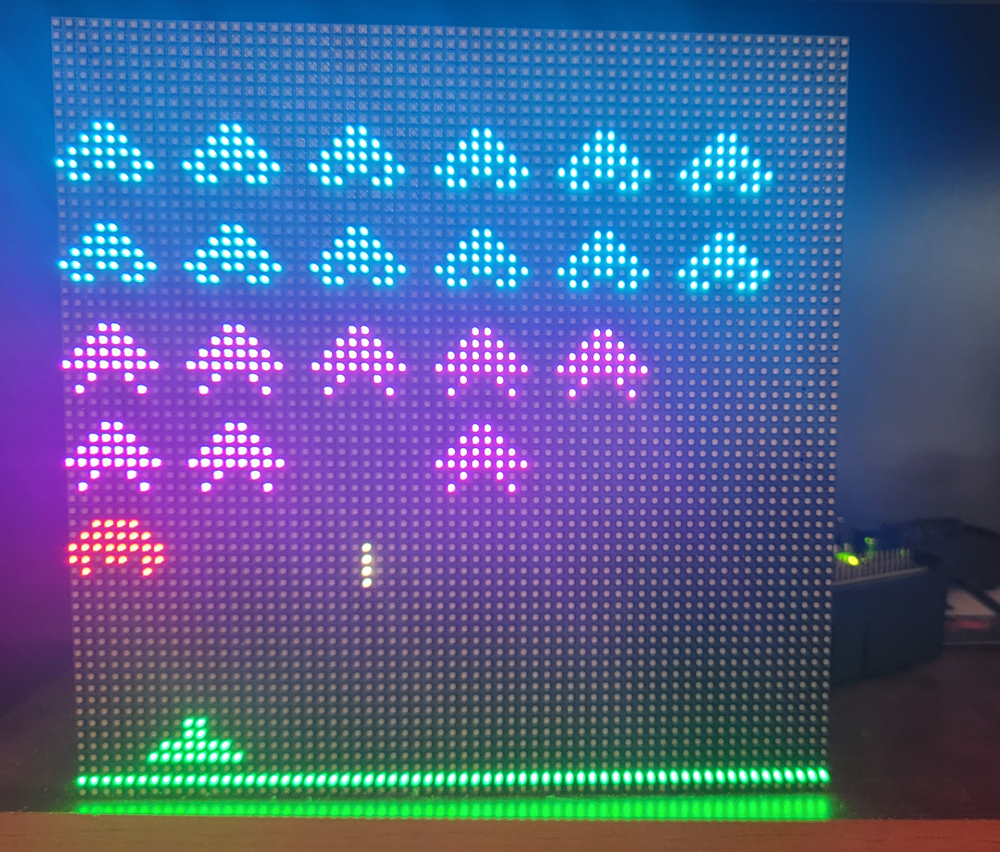
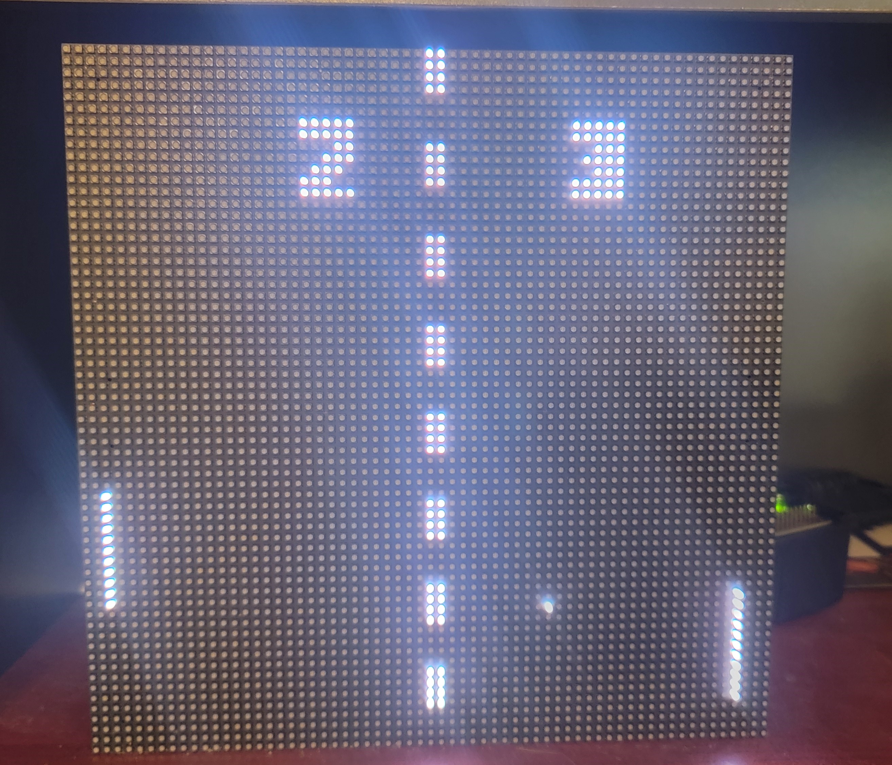

# Pixil LED Matrix (C++)

**Pixil** is an all-in-one kit: write a short script, and it runs it live on a Raspberry Pi LED matrix—language and display runtime in one package.

This is the **native C++** runtime. Same Pixil language (`.pix`), same show library—rewritten end-to-end so the live path no longer depends on Python.

**You compile it once on the Pi** (there is no prebuilt binary download). After `make`, you only edit `.pix` scripts—you do not write C++ to run a show. Rebuild when you pull runtime changes.

**Want a new script built by Claude, Grok, ChatGPT, etc?** Give AI [docs/Pixil_Scripting_Guide.md](docs/Pixil_Scripting_Guide.md) and tell AI what you want. It will build the script for you.



> Looking for the original Python edition? See **[pixil-led-matrix](https://github.com/kklasmeier/pixil-led-matrix)**. Prefer **this** repo for new installs and daily shows.

---

## Why this version?

The Python Pixil stack proved the language and grew a large script library. The C++ edition keeps that creative model and replaces the runtime:

| | Python (`pixil-led-matrix`) | **C++ (this repo)** |
|---|---|---|
| Live path | Python producer + Python consumer | **Native `pixil` + `pixil-consumer`** |
| Producer speed | Baseline | **~76× geometric mean faster** (217 scripts, Pi 4; see [docs/BENCHMARK.md](docs/BENCHMARK.md)) |
| Startup | ~0.7 s | **~0.01 s** |
| Drawing depth | One drawing surface; sprites always on top | **Drawing layers** — sprites sit *between* scenery bands |
| Sprites | Size 1×, upright, whole pixels | **Scale, flip, spin, tilt**, centre/top-left anchor, sub-pixel moves |
| Ops | `Pixil.py` / scripts | **`./run start` / `status` / `next` / `stop`** |
| CI / headless | Limited | **`--headless`**, `--dry-run`, buffer fingerprint, unit tests |
| Scripts | 125+ `.pix` | **Same language**, 250+ scripts in `scripts/main` |

**Bottom line:** if you want the smoothest show, modern sprite features, and a runtime you can build and test without Python on the panel path—use this repo.



---

## Overview

Pixil abstracts LED matrix control into a small scripting language: plot pixels, draw shapes, animate sprites, scroll backgrounds, and pace frames—without writing C++ or wiring GPIO by hand.

This repo runs that language with a **producer / consumer** design:

- **`pixil`** parses and runs your `.pix` script
- **`pixil-consumer`** owns the panel (or a headless buffer) and draws commands from a queue

Scripts stay the product. The engine is there so they look good and stay fast on a Pi 4.



---

## AI Built

This project has been built through AI collaboration. As a product owner by trade (not a full-time developer), I ship Pixil by working with AI in small increments—design, implement, test on the real panel, refine.

The show scripts follow the same loop: describe an idea, generate a `.pix` file against the [scripting guide](docs/Pixil_Scripting_Guide.md), run it on the matrix, and polish until it feels right.

If you use Pixil or review the C++ design, I’d love to hear from you—especially developer feedback on structure and clarity.

---

## What’s new vs Python Pixil

### Drawing layers
Scenery and sprites stack by layer number. A fox can walk **between** far trees and near trees instead of always sitting on top of every plot. See the [scripting guide §14](docs/Pixil_Scripting_Guide.md#14-drawing-layers) and `scripts/main/Layered_Aquarium.pix`.

### Sprite transforms
Per-instance **scale** (0.1×–8×), **flip**, flat **angle** (degrees), **tilt** (card/coin foreshortening + optional back cel), and **anchor** (top-left or centre). Float `x,y` keeps slow motion smooth when transformed. See [scripting guide §13 — Sprite Transforms](docs/Pixil_Scripting_Guide.md#sprite-transforms) and `scripts/tests/Sprite_Transforms_Demo.pix`.

### Native performance
Producer wall time on a Pi 4 is typically **orders of magnitude** below the legacy Python producer for the same scripts (median ~100× raw in the published suite). That headroom means denser scenes, more sprites, and less queue backlog before the panel catches up.

### Show operations
```text
./run start          # playlist (default: scripts/main)
./run status
./run next
./run jump main/Aurora_Borealis.pix
./run stop           # blacks the panel out
```

---

## Getting started

### You have to compile it

Unlike the Python edition (`python Pixil.py …`), this runtime is **C++ source**. Clone the repo, install a C++ toolchain, and **build with `make`** on the machine that drives the matrix (typically a Pi 4). That produces `pixil` and `pixil-consumer`. Day-to-day you only change `.pix` files and use `./run`—no recompile unless the engine itself changed.

Optional: `make test` after building.

### Requirements
- Raspberry Pi (show hardware: Pi 4 + 64×64 RGB matrix; you can edit scripts elsewhere)
- **g++ ≥ 12 (C++20)** and **GNU make** (to compile)
- [hzeller/rpi-rgb-led-matrix](https://github.com/hzeller/rpi-rgb-led-matrix) / `librgbmatrix` for hardware (headless builds work without it)

### Build, then run

```bash
git clone https://github.com/kklasmeier/pixil-led-matrix-cpp.git
cd pixil-led-matrix-cpp

# Compile the runtime (needed once, and again after pulling engine updates)
nice -n 19 make -j2
# make test   # optional

# One script for 20 seconds (interactive)
./run interactive -- main/Aurora_Borealis.pix -t 0:20

# Full show in the background
./run start -- main/* -t 5:00
```

Paths are relative to `scripts/` unless they are already a file. Full ops notes: [docs/OPS.md](docs/OPS.md).

### Documentation
| Doc | What it is |
|---|---|
| [docs/Pixil_Scripting_Guide.md](docs/Pixil_Scripting_Guide.md) | **Language reference** (drawing, sprites, layers, transforms, …) |
| [docs/OPS.md](docs/OPS.md) | Build, `./run`, status, blackout |
| [docs/BENCHMARK.md](docs/BENCHMARK.md) | Native vs Python producer timings |
| [DEVIATIONS.md](DEVIATIONS.md) | Intentional differences vs legacy Python |
| [docs/CUTOVER.md](docs/CUTOVER.md) | Daily show cutover notes |

---

## Features

### Core language
- Drawing: plot, line, rectangle, circle, polygon, ellipse, arc
- Frames: `begin_frame` / `end_frame` (clear or preserve)
- Variables (`v_…`), expressions, arrays, procedures
- Control: if / elseif / else, for, while
- Math: trig, random, rounding, min/max, …
- Batch plotting: `mplot` / `mflush`
- Burnout: instant or fade
- Text (bitmap fonts) and `fps` / `rest` pacing

### Sprites & motion
- Multi-cel sprites, instances, auto-advance on move
- Layer assignment + `z_index` within a layer
- **Transforms:** scale, stretch, flip, angle, tilt, back cel, anchor
- Scrollable **background** layers under the drawing stack

### Runtime
- Native producer → consumer IPC ([ADR-001](docs/ADR-001-ipc.md), [ADR-002](docs/ADR-002-native-consumer.md))
- Headless / dry-run / fingerprint for testing without the panel
- Playlist control via `./run`



---

## Example scripts

`scripts/main` holds **250+** ready-to-run shows, including:

- **Effects:** Aurora Borealis, Electric Arcs, Fireworks, Plasma-style fields  
- **Sims:** Boids, Double Pendulum, Cloth, Falling Sand  
- **Games:** Breakout, Pong, Snake, Space Invaders, Tetris, Flappy Bird  
- **Depth demos:** Layered Aquarium, Asteroid Dogfight  
- **Nature / space:** Fish Tank, Coral Reef, Cosmic Nebula, Fireflies  

Try:

```bash
./run interactive -- main/Layered_Aquarium.pix -t 1:00
./run interactive -- tests/Sprite_Transforms_Demo.pix -t 2:00
```

---

## Quick language taste

```text
fps(30)

define_sprite(ship, 8, 5)
    draw_rectangle(0, 1, 6, 3, cyan, 100, true)
    plot(7, 2, white, 100)
endsprite

show_sprite(ship, 32, 32)
set_sprite_anchor(ship, 1)
set_sprite_layer(ship, 20)

while true then
    begin_frame
        set_layer(10)
        draw_circle(32, 40, 18, navy, 40, true)   # water behind the ship
        set_sprite_angle(ship, v_t * 3)
        set_sprite_scale(ship, 1.0 + 0.3 * sin(v_t * 0.1))
        move_sprite(ship, 32 + sin(v_t * 0.05) * 10, 32)
    end_frame
    v_t = v_t + 1
endwhile
```

Full reference: [docs/Pixil_Scripting_Guide.md](docs/Pixil_Scripting_Guide.md).

---

## Project layout

| Path | Role |
|---|---|
| `src/runtime/` | Values, operators, evaluator |
| `src/syntax/` | Lexer, parser, AST |
| `src/emit/` | Draw / sprite batch packing |
| `src/ipc/` | Producer → consumer link |
| `src/host/` | `pixil` CLI |
| `src/consumer/` | `pixil-consumer` (panel / headless) |
| `scripts/main/` | Show library |
| `scripts/tests/` | Demo / test scripts (not the daily playlist) |
| `docs/` | Ops, language guide, ADRs, specs |
| `./run` | Show launcher |

---

## Interest

If you build something with Pixil, star the repo, open an issue, or reach out—I’d love to see it. The Python edition remains available for history and comparison; **new work should start here.**

---

## Acknowledgments

- [rpi-rgb-led-matrix](https://github.com/hzeller/rpi-rgb-led-matrix) by Henner Zeller  
- Adafruit RGB Matrix Bonnet / HAT ecosystem  
- The original [pixil-led-matrix](https://github.com/kklasmeier/pixil-led-matrix) Python runtime that proved the language
